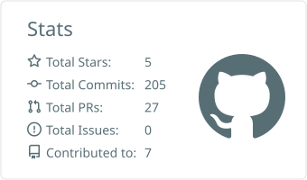
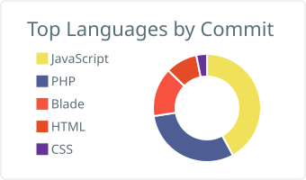

<h1 align="center">Gabriel Bianchi Britto</h1>

  Desenvolvedor full-stack em Jerônimo Monteiro – ES. 
  Construo sistemas completos, do problema de negócio até a operação em produção.

---

### Agora

**Sócio e desenvolvedor na [ORBTEX](https://orbtexbrasil.com.br).** Trabalho no [Gestão 360º](https://gestao.orbtexbrasil.com.br), um CRM para corretoras de seguro, saúde e consórcio, e no Events, de gestão de eventos e participantes.

**Fundador da [DataCycle Tech](https://datacycletech.com.br).** Lá mantenho quatro sistemas próprios em produção. Cada um existe por causa de uma regra de negócio:

| Sistema | Para quem | A regra que ele protege |
| :-- | :-- | :-- |
| **RECeBa** | Projeto Ciclos, IFES Campus de Alegre | Doações de vários parceiros, sem entrega duplicada para a mesma família |
| **[PSY Task](https://psytask.com.br)** | Psicólogos e clínicas | O prontuário clínico fica separado da gestão do consultório |
| **[Eloziva](https://eloziva.datacycletech.com.br)** | Famílias e cuidadores em casa | Uma dose sem confirmação nunca é registrada como "não tomada" |
| **[Rota](https://rota.datacycletech.com.br)** | Profissionais autônomos | Na conciliação de check-ins, o nome do aluno não basta para identificá-lo |

### Antes

Desenvolvedor e Tech Lead na RADA. Fiz parte da equipe do **Projeto Ciclos**, que organiza doações de alimentos e oferece capacitação profissional direcionada a vagas já identificadas. O RECeBa nasceu ali e virou meu TCC em Análise e Desenvolvimento de Sistemas no IFES Campus de Alegre.

### Ferramentas

- **Linguagens e frameworks:** HTML, CSS, JavaScript, PHP, Laravel, Livewire, Tailwind CSS e Alpine.js
- **Banco de dados:** MySQL
- **Mobile:** React Native com Expo
- **Workflow:** macOS, Windows e VS Code

  &nbsp;
  &nbsp;
  &nbsp;
  &nbsp;
  &nbsp;
  &nbsp;
  &nbsp;
  &nbsp;
  &nbsp;
  

### No GitHub

  <picture>
    <source media="(prefers-color-scheme: dark)" srcset="https://raw.githubusercontent.com/GabrielBritto1/GabrielBritto1/main/profile-summary-card-output/github_dark/3-stats.svg">
    
  </picture>
  <picture>
    <source media="(prefers-color-scheme: dark)" srcset="https://raw.githubusercontent.com/GabrielBritto1/GabrielBritto1/main/profile-summary-card-output/github_dark/2-most-commit-language.svg">
    
  </picture>

  <picture>
    <source media="(prefers-color-scheme: dark)" srcset="https://raw.githubusercontent.com/GabrielBritto1/GabrielBritto1/output/cobrinha-dark.svg">
    
  </picture>

### Vamos conversar

  
  
  

